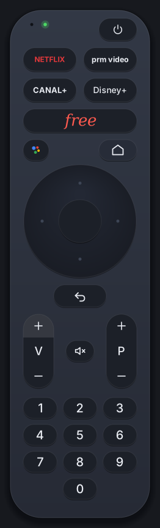

# Télécommande Freebox Pop pour Linux

Une télécommande pour le **Player Pop** de la Freebox, utilisable depuis un
ordinateur Linux. Elle reproduit la disposition de la télécommande physique
dans une fenêtre détourée (sans cadre, fond transparent), avec une icône dans
la zone de notification.



> Projet non officiel, sans lien avec Free. « Freebox », « Netflix »,
> « Prime Video », « Canal+ » et « Disney+ » sont des marques de leurs
> propriétaires respectifs ; elles ne servent ici qu'à nommer les boutons.

## Comment ça marche

Le Player Pop tourne sous Android TV. Le projet utilise le protocole
« Android TV Remote v2 » (le même que l'appli Google TV) via la bibliothèque
[`androidtvremote2`](https://pypi.org/project/androidtvremote2/) : appairage
par code affiché à l'écran, puis envoi des touches sur le réseau local.

```
fenêtre GTK / page web  ──HTTP──▶  app.py (aiohttp)  ──TLS──▶  Player Pop
      (tray.py)                    127.0.0.1:8765
```

| Fichier | Rôle |
| --- | --- |
| `app.py` | Serveur local : appairage, envoi des touches, lancement d'applis |
| `remote_art.py` | Dessin de la télécommande (cairo) et zones cliquables |
| `remote_window.py` | Fenêtre GTK détourée, souris, clavier, appairage |
| `tray.py` | Icône de zone de notification, démarre le serveur et la fenêtre |
| `index.html` | Version web de la télécommande (alternative sans GTK) |
| `install.sh` | Lanceur dans le menu des applications, démarrage automatique |

## Installation

Testé sous Linux Mint (Cinnamon), Python 3.12.

```bash
git clone <url-du-depot> freebox-remote
cd freebox-remote

# Serveur : dans un environnement virtuel (Debian/Ubuntu interdisent pip global)
sudo apt install python3-full python3-venv
python3 -m venv .venv
.venv/bin/pip install -r requirements.txt

# Icône de notification et fenêtre native (Python du système)
sudo apt install python3-gi python3-gi-cairo python3-cairo gir1.2-gtk-3.0 \
    gir1.2-ayatanaappindicator3-0.1
```

Trouve l'IP du Player (interface de la box, ou `ip neigh`), puis :

```bash
chmod +x install.sh
./install.sh 192.168.1.NN --autostart    # --autostart : lancement à l'ouverture de session
```

Lance « Télécommande Freebox » depuis le menu des applications. Au premier
lancement, un code s'affiche sur la TV : saisis-le dans la fenêtre d'appairage.
Les certificats sont conservés dans `~/.config/freebox-remote/`.

### Sans icône de notification

```bash
.venv/bin/python app.py --host 192.168.1.NN
```

puis ouvre <http://127.0.0.1:8765> dans un navigateur.

## Utilisation

- **Icône de notification :** clic gauche = affiche la télécommande au premier
  plan sur l'espace de travail courant ; nouveau clic = la masque. Clic droit =
  menu (version web, relancer le serveur, quitter). Ce comportement utilise
  `Gtk.StatusIcon`, choisi automatiquement sous Cinnamon. Sur un autre bureau,
  l'icône ouvre un menu dont le premier élément fait la même chose. On peut
  forcer un mode avec `FREEBOX_REMOTE_BACKEND=gtk`, `appindicator` ou `xapp`.
- Clique sur les boutons, ou utilise le clavier : flèches, Entrée (OK),
  Échap / Retour arrière (retour), `0`-`9`, `+` / `-` (volume), `M` (muet),
  Page préc. / suiv. (programme), `H` (accueil), `P` (veille), `A` (assistant),
  `N` (Netflix).
- Fenêtre native : glisser sur le corps pour la déplacer, clic droit pour le
  menu. Sa position est mémorisée.
- Taille : écris un facteur (par exemple `0.8`) dans
  `~/.config/freebox-remote/scale`, ou définis `FREEBOX_REMOTE_SCALE`.
- La LED en haut est verte quand le Player est connecté.

## Personnalisation

Les boutons d'applis (Netflix, Prime Video, Canal+, Disney+, free) envoient des
liens de lancement définis dans `APPS` au début de `app.py`. Le bouton « free »
utilise un identifiant que je n'ai pas pu confirmer : adapte-le à ton Player
(par exemple avec `adb shell pm list packages`). Les codes de touches sont dans
`KEYS`.

## Limites connues

- Pas de retour vidéo : ce sont uniquement des commandes.
- Le Player doit être allumé et joignable sur le réseau local.
- Testé sur un seul Player Pop ; les noms de touches de certains boutons
  (assistant, programme +/-) peuvent varier selon la version du firmware.

## Licence

[MIT](LICENSE)
